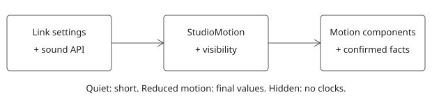

The Studio mounts `StudioMotion` in `main.tsx`. Vite reads the link lane's settings and sound modules when they exist. Until then, sound is silent. There is no second settings store.

The screen hooks are small. Readiness and Model quality use `GradeFlip` and `BigWin`. Pending changes uses `BulkCount` after a confirmed apply. Diagram uses `RelationshipSnap` only for new, confirmed relationships. Publish uses `PublishDraw` after a clean result. History uses `HistoryMotion` for confirmed undo and redo from either writer.

`JevSettle` takes `choices: { id, label, confidence }[]`, `chosenId` and `eventKey`. Confidence is between zero and one. Only the engine's selected id gets “Jev chose this”. Sorting never selects a winner. The current Studio DTOs do not provide candidate confidences. The component is verified against a fixture and awaits that data source.

`NextGlide` is the next-step hook. Wrap the next-step lane's `NextLine` content with it. Change `eventKey` when the confirmed next step changes. `NextMotionStub` proves the animation until that lane joins.

The undo number is the original History change number. The live model revision increases during undo, so it cannot count down. A filtered or partial History says “shown changes”. Missing numbers remain absent.

The S uses fixed path pieces. Only their opacity changes. Relationships and sparkles use transform and opacity. Counts use finite animation frames without layout reads. Hidden, offscreen and reduced-motion surfaces finish with the same information. Quiet uses short motion and suppresses sound and sparkle.

The link sound adapter calls `play` for ticks, snaps, pops and chimes. Undo and Jev cues stay silent because the link palette has no voices for them yet. Sound is Off by default. Errors do not animate. Production publish retains the plain S and has no sparkle.

1. Run `node --test Semanticus.VSCode/webview/src/personality/motion/state.test.mjs` from the repository root.
2. Run `node Semanticus.VSCode/webview/src/personality/motion/verify-browser.mjs` for the browser checks and dark/light frames.
3. Read the generated PNGs in `/tmp/semanticus-joint-review/m15/motion/shots`.

The fixture and screenshot driver use the real motion components and Studio tokens. The engine is mocked. They do not prove a live publish or native VS Code behavior.
